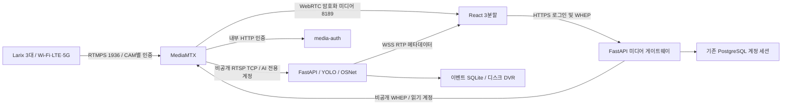

# AWS MediaMTX 배포 준비 및 운영

이 문서는 배포 절차다. 이번 작업에서 AWS 리소스 생성, 원격 push, 실제 AWS 배포는 수행하지 않았다.
Windows에는 Docker가 없어 Docker 빌드/실행 검증은 남아 있다. MediaMTX 자체는 네이티브 실행으로 시험한다.

## 데이터 흐름



기존 직접 RTSP/HTTP/USB/파일 입력은 `CAMERA_nn_INPUT=direct`와 기존 SOURCE로 유지한다.
Push 입력은 `cam01`, `cam02`, `cam03`이며 세 채널을 모두 연결할 필요는 없다.
라이브 영상은 AI FPS와 분리되고, AI 입력은 최신 프레임 한 장을 소비한다. DVR은 기존 JPEG+JSON 기록 방식이다.
원본 RTMPS 전 프레임 녹화 기능을 새로 추가한 것은 아니다.

## 공개 포트 및 DNS

| 접점 | 공개 여부/대상 |
|---|---|
| HTTPS TCP 443 | 로그인/웹/API/WSS, 호스트의 TLS 프록시 또는 ALB |
| RTMPS TCP 1936 | MediaMTX, 폰 송출 허용 |
| WebRTC UDP 8189 | 기본 미디어 경로 |
| WebRTC TCP 8189 | UDP 제한망용 대안, 지연 증가 가능 |
| RTSP 8554 / WHEP 8889 / 관리 9997 | Docker 내부 전용, 호스트 publish/SG 허용 금지 |
| 인증 8003 / FastAPI 8002 / PostgreSQL 5432 | Docker 내부 전용 |
| 웹 8080 | 기본 127.0.0.1 바인딩, HTTPS 프록시 뒤에서만 사용 |

`STREAM_PUBLIC_HOST`는 실제 EC2의 안정적인 공인 IP를 가리키는 DNS로 설정한다.
MediaMTX는 이 DNS를 ICE 후보로 알린다. Docker 매핑·AWS SG·운영체제 방화벽의 프로토콜/포트를 일치시킨다.
공개 서버에 도달할 수 있으면 폰과 PC는 같은 Wi-Fi에 있을 필요가 없다.
[MediaMTX ICE 연결 안내](https://mediamtx.org/docs/features/webrtc-specific-features).

ALB는 HTTP/HTTPS와 WebSocket용이다. RTMPS/ICE를 ALB의 HTTP 경로에 넣지 않는다.
이 구성에서는 스트림을 EC2에 직접 전달한다. NLB 도입 시 TCP/UDP와 대상 포트/주소를 별도 검증한다.
[AWS ALB listener 규격](https://docs.aws.amazon.com/elasticloadbalancing/latest/application/load-balancer-listeners.html).
현재 브라우저 구현은 서버의 UDP/TCP ICE 후보를 사용하며 TURN 발급/전달 연동은 미구현이다.

## 배포 전 준비

1. 현재 DB/녹화 볼륨의 백업과 복구 가능성을 확인한다. 기존 Compose 프로젝트 이름을 유지한다.
2. 운영 `.env`가 있으면 보존하고 필요한 항목만 추가한다. 예제를 운영 파일 위에 덮어쓰지 않는다.
3. `PUBLIC_APP_URL=https://실제웹도메인`, `COOKIE_SECURE=true`, `LOCAL_DEMO_ENABLED=false`를 설정한다.
4. 기존 PostgreSQL의 `DATABASE_URL`을 사용한다. RDS 사용 시 기존 CA와 verify-full을 유지한다.
5. `models/best.pt`에 학습한 실제 가중치를 두고 모델 클래스가 기존 보호구 규격과 일치하는지 검증한다.
   `REID_MODEL_PATH=/models/osnet_x0_25.onnx`로 설정한다. 샘플/fixture를 실제 모델로 대체하지 않는다.
6. `STREAM_PUBLIC_HOST`, `MONITOR_AUTOSTART=true`, 분석 FPS, 녹화 용량/보존 기간을 환경에 맞게 설정한다.
7. `tools/issue_stream_credentials.py --host 실제송출DNS`로 `.env.media`와 개인용 휴대폰 연결 파일을 생성한다.

실제 값과 비밀번호를 콘솔/공유 로그에 출력하지 않는다. `docker compose config`는 보간한 비밀번호를 출력할 수 있으므로 검증은 `config --quiet`를 사용한다.

## TLS

실제 송출 DNS의 공인 인증서와 개인키를 `.secrets/media-tls/fullchain.pem`, `privkey.pem`에 제공한다.
전체 디렉터리를 읽기 전용 마운트하므로 다른 경로로 향하는 인증서 심볼릭 링크 대신 실제 인증서/키 파일을 안전하게 배치한다.
호스트의 ACME 클라이언트로 발급·자동 갱신하고 접근 권한을 제한한다.
갱신 후 인증서 SAN/만료/체인 검증 → 파일을 원자적으로 교체 → MediaMTX 재시작 → 폰 재연결 순서를 운영 절차로 둔다.
갱신 실패와 만료 임박 경보가 필요하다. 웹 HTTPS 인증서는 웹 프록시에도 별도로 적용한다.
네이티브 시험의 로컬 CA 인증서를 운영 휴대폰 배포용으로 사용하지 않는다.

## Compose 명령 (AWS 실행은 아직 하지 않음)

프로젝트 루트에서 운영 파일/가중치/인증서 준비 후 실행한다.

```sh
docker compose -f compose.monitor.yaml -f compose.media.yaml config --quiet
docker compose -f compose.monitor.yaml -f compose.media.yaml build
docker compose -f compose.monitor.yaml -f compose.media.yaml up -d
docker compose -f compose.monitor.yaml -f compose.media.yaml ps
```

`web`은 기본 호스트 127.0.0.1:8080이다. 호스트 HTTPS 프록시에서 해당 주소로 전달한다.
ALB를 사용한다면 웹 바인딩과 대상 SG를 ALB에서만 접근되게 구성해야 한다. 현재 파일만으로 HTTPS 종료가 자동 생성되지는 않는다.
서버 TLS 프록시는 API의 Origin/Host, WebSocket Upgrade를 유지하고 HTTP→HTTPS 리디렉션을 적용한다.
`deploy/nginx.monitor.conf`가 내부 웹→백엔드 API와 WSS 업그레이드를 전달한다.

정지 시 다음 명령을 사용한다. 데이터 볼륨은 삭제하지 않는다.

```sh
docker compose -f compose.monitor.yaml -f compose.media.yaml stop
```

## 권한 및 장애 처리

- 각 게시 계정은 자기 경로의 RTMP 프로토콜 publish만 허용한다. RTMPS strict이므로 평문 RTMP 리스너는 없다.
- AI는 RTSP read만, 웹 게이트웨이는 WebRTC read만, 관리 계정은 API만 허용한다.
- 브라우저에는 내부 계정/비밀번호를 전달하지 않는다. 로그인 세션으로 WHEP를 대리 요청하며 세션 소유권, TTL, 로그아웃/만료를 확인한다.
- 브라우저→게이트웨이는 웹과 같은 origin으로 운영한다. 미디어는 WebRTC 암호화 채널이다.
- 게시 계정 교체는 새 연결에 적용된다. 이미 연결된 송출을 즉시 차단하려면 해당 게시 세션을 내부 관리 API로 끊거나 MediaMTX 재시작을 계획한다.
- 인증 서비스 장애 시 새 연결은 거부한다. 내부 네트워크/로그에 비밀번호나 쿼리 URL을 기록하지 않는다.
- 카메라 중단 시 그 경로만 오프라인이 된다. AI 오류와 영상 수신 상태는 별도로 표시한다.

## 시간 및 ReID 한계

RTP 원시 시각으로 같은 채널의 재생 프레임과 분석 텍스트를 정확히 맞춘다. 메타데이터가 늦거나 브라우저가 RTP 시각을 제공하지 않으면 위치 텍스트를 숨긴다.
수신 시각은 실제 촬영 시각이 아니다. Push 간 자동 ReID 연결은 신뢰할 수 있는 송신 시각 구현 전까지 비활성화한다.
OSNet 특징 추출, 채널별 추적/ID/이벤트와 기존 직접 입력 ReID는 유지한다. 촬영 시계 지원과 실제 현장 데이터 검증은 후속 개발 항목이다.

## 운영 인수 조건

Docker 이미지 빌드, PostgreSQL 실제 세션, 유효한 공인 TLS, 카메라별 잘못된 인증 차단, 비로그인 시청 차단,
한 채널 장애 독립성, 3대 실제 Larix LTE/Wi-Fi, CPU/GPU YOLO 처리량, 촬영→표시 지연, 실제 ReID 정확도를 확인한다.
CPU/RAM/디스크/수신 FPS/AI FPS/재연결 횟수와 녹화 누락을 감시한다. 로그는 Compose에서 회전한다.
디스크 소진과 프로세스 중단 복구, DB/녹화 백업 복원, 24시간 부하 시험은 운영 전 필수 미완료 항목이다.
Docker `restart: unless-stopped`는 종료 프로세스 재시작 정책이며 unhealthy 컨테이너를 자동으로 재시작해주는 보장은 아니다.
외부 상태 감시/알림과 재시작 대응을 별도로 운영한다.

## Windows 재현

```powershell
.\.venv\Scripts\python.exe tools/prepare_mediamtx.py
$env:PLAYWRIGHT_BROWSERS_PATH='C:\vscode\.playwright-browsers'
.\.venv\Scripts\python.exe tools/test_media_integration.py
```

통합 시험은 loopback 전용 별도 포트/개인 인증서/합성 FFmpeg 및 검출 fixture를 사용한다.
기존 운영 DB나 로컬 기본 서버 포트는 사용하지 않는다. 결과는 `docs/media-integration-result.json`에 저장한다.
실패 원인과 다음 재개 지점은 [CODEX-PROGRESS.md](CODEX-PROGRESS.md)를 확인한다.
